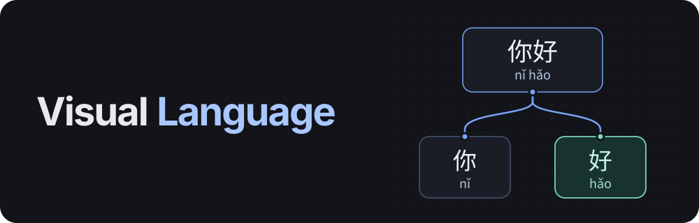

# Visual Language



Visual Language is a Mandarin learning app. Have conversations, explore different
replies, and look up words as you read. Create lessons from your conversations or
topics you choose, then practice with multiple-choice questions and return for
scheduled reviews.

[Features](#features) · [Getting started](#getting-started) · [Usage](#usage) ·
[How it works](#how-it-works) · [Providers](#providers) ·
[Troubleshooting](#troubleshooting) · [Development](#development) · [License](#license)

## Features

- **Branching conversations.** Continue from any message, try a different reply,
  and keep related conversations together. Topics, bookmarks, and search help you
  return to earlier material.
- **Read and listen.** Show pinyin alongside Chinese text, hear a sentence, and
  select words for dictionary definitions. Open a response in the full-size reader
  to study it without zooming around the conversation.
- **Save useful language.** Save words and phrases with their original context,
  then use them in a lesson or vocabulary review.
- **Three lesson styles.** Learn about a topic, practice a scenario, or read a
  short passage about something that interests you.
- **Practice and quizzes.** Work through examples and guided questions, then take
  a separate quiz. Lesson answers are multiple choice; you do not need to type
  Chinese characters or pinyin.
- **Scheduled review.** Build lesson progress across four levels, keep a daily
  streak, and practice between reviews. Resume unfinished lessons or archive ones
  you want to set aside.
- **Saved work.** Conversations, lessons, and results stay in your browser. Export
  a workspace backup, restore it later, or install the app on a supported browser.

## Getting started

You need **Node.js 22 (22.12+) or 24**, npm, and an API key from a supported provider.

From the project directory:

```bash
npm install
npm run dev
```

Open the URL printed by Vite, then:

1. Open **Settings → AI connection**.
2. Choose your provider. **Nebius** is selected by default. The link below the API
   key field opens that provider's account page.
3. Paste your API key. Keep the default model or choose another one available to
   your account.
4. Select **Test connection**, then **Save connection**.
5. Send a message to begin. **Ctrl+Enter** sends; Enter adds a new line.

To look around without a key, open **Try demo**, enter the demo workspace, and
select **Try sample lesson**. Learn to order tea, practice, and take a short quiz.
The demo uses saved sample content. Live AI and the demo clock are in **Demo options**.

## Usage

### Turn a conversation into a lesson

For example, start a conversation with:

> Help me order noodles at a restaurant. I am a beginner learning Mandarin.

1. Read the Mandarin reply with pinyin. Select a word to see its meaning, or open
   **Read this response** using the book button. You can look up words while a
   sentence is playing.
2. Choose **Save for practice** on words or phrases you want to learn.
3. Select **Practice this conversation**. Choose the saved phrases, lesson
   objective, and quiz level, then select **Prepare lesson**.
4. Follow the examples and answer the guided practice questions. Practice gives
   feedback immediately and offers help when you need it.
5. Take the final **Quiz**. Results and explanations appear after you submit it.

Select an earlier message to try another conversational direction. **New topic**
opens a fresh conversation; previous trees remain available through **Topics**.

### Create a lesson from an interest

Open **Explore** and choose a lesson type:

| Lesson type | Example request | What you study |
| --- | --- | --- |
| Learn about a topic | Ordering Chinese food | Related expressions and how to use them. |
| Practice a scenario | Asking a station attendant where to change trains | Language for your role and goal in a situation. |
| Read a short passage | Tea culture | A short Mandarin passage and useful language from it. |

Choose a quiz level and select **Create lesson**. The app prepares the material,
lesson examples, practice questions, and final quiz. Progress is saved as it goes;
you can pause and continue later.

An optional **Tavily** key adds web sources. Without one, lessons use AI-written
practice material. Web sources are saved with the lesson so you can revisit them.

### Choose how much reading support you want

The four quiz levels combine answer direction with pinyin support:

| Quiz level | Read | Choose |
| --- | --- | --- |
| Understand with pinyin | Chinese with pinyin | An English answer |
| Choose Mandarin with pinyin | English | A Chinese answer with pinyin |
| Understand without pinyin | Chinese characters | An English answer |
| Choose Mandarin without pinyin | English | A Chinese answer without pinyin |

Language complexity and topic scope are separate lesson settings. You can work on
character recognition without also making the sentences or subject harder.
Pinyin is shown by default in conversations; turn it off in **Settings → Reading**
when you want less support.

### Return for review

Open **Lessons** to find your saved lessons and progress. The main button shows
**Learn**, **Continue**, **Practice**, or **Review**, depending on the lesson's
state. Due reviews glow; when none are due, **Create a lesson** glows instead.

Passing a lesson's first quiz earns one point. Later points come from passing
scheduled reviews. Every quiz answer must be correct without help to earn the
point, and you can retry until you pass. Levels 1–4 require **1, 3, 6, and 10**
points respectively. Extra practice is available between reviews.

Completing a lesson, practice session, or review counts toward your daily streak,
even if you have not passed the quiz. The learning day starts at **3:00 a.m.** in
your browser's time zone by default; change it in Settings.

**Daily review** revisits individual saved words and phrases. **Library** holds
those study cards and your saved explanations. Archiving a lesson keeps its
progress and history; restoring it makes it available again.

## How it works

Visual Language is built with **Svelte 5**, **TypeScript**, **Svelte Flow**, and
**Vite**. It runs in the browser and calls the selected AI provider directly.
The project is being built for the **Nebius Token Factory hackathon**.

Lesson creation uses native tool calling in a sequence of small steps:

1. Ground the request and review a plan of concrete language to teach.
2. Build and review the lesson graph one teaching point at a time, using the
   accepted graph as context for the next step.
3. Propose questions that cover gaps, then write, solve, and review each question
   and its answer choices. Existing question prompts stay in context to reduce
   repetition.
4. Check coverage across both guided practice and the final quiz, and save the
   prepared lesson.

The interactive lesson uses these saved materials without further generation.
Completed generation stages and accepted content are retained when preparation
is interrupted.

Pinyin and dictionary lookup run locally. Sentence playback uses your browser's
speech voices. An optional contextual pronunciation pack is available under
**Settings → Audio & pinyin**.

### Data and backups

Conversations, lessons, answers, and review history are stored in **IndexedDB**.
API keys are stored separately in this browser's **localStorage** and sent to
their configured provider. AI requests send the conversation or lesson context
needed for the current task; Tavily requests send the search topic.

Use **More → Backup & restore** to download or restore your workspace. Backups
exclude API keys. There is no automatic cross-device sync.

The installable app can reopen saved work without a connection. New AI responses,
lesson generation, and web search need an internet connection.

## Providers

**Nebius Token Factory** is the default connection. The initial model ID is
`deepseek-ai/DeepSeek-V4-Flash-0731`; you can load available models or enter a
different ID in **Choose another model**.

Built-in connection options also include **Featherless**, **OpenAI**,
**Anthropic Claude**, **Google Gemini**, **Alibaba Cloud**, **MiniMax**, and
**OpenRouter**. A **Custom endpoint** option accepts an OpenAI-compatible HTTPS
API. Each provider keeps its own saved connection settings.

For lesson generation, choose a model with native tool calling. Model access,
account restrictions, and browser API support depend on the provider.

Add a Tavily key under **AI connection → Optional web search** to enable web
retrieval. It is separate from your AI provider key.

## Troubleshooting

| Problem | What to try |
| --- | --- |
| A connection test fails | Check the selected provider, API key, and model ID. For a custom endpoint, check the URL and browser access support. |
| A connection works but lesson creation stops | Reopen the saved lesson and continue preparation. The model must support native tool calling; another available model may work better. |
| Lesson creation is taking a while | Generation can take several minutes. The progress panel shows the current stage; pausing keeps completed work. |
| Sentence audio is unavailable | Open **Settings → Audio & pinyin**, check for a Mandarin voice, and try the voice sample. Available voices depend on the browser and operating system. |
| Earlier conversations are out of view | Open **Topics** and select the conversation. The canvas shows one topic at a time. |

This is a hackathon prototype. Generated Mandarin and pronunciation have not yet
passed independent language review.

## Development

| Command | Purpose |
| --- | --- |
| `npm run dev` | Start the development server. |
| `npm run build` | Build the static app into `dist/`. |
| `npm run preview` | Serve the production build locally. |
| `npm run check` | Check Svelte and TypeScript. |
| `npm test` | Run the unit tests. |
| `npm run test:browser` | Build and run the Playwright browser journeys. |
| `npm run test:pages` | Rehearse installation, updates, and recovery under a deployment subpath. |
| `npm run test:secrets` | Check that production artifacts exclude synthetic test keys. |

Install Chromium once before running browser tests:

```bash
npx playwright install chromium
```

Live generation and evaluation tools are in [`scripts/`](scripts/). Start with
`npm run test:lesson-generation -- --help` or
`npm run eval:lessons -- --help`. Live runs use provider credits; prerecorded test
fixtures do not.

For optional local testing, `.env.example` lists provider key variables. Development
mode makes those keys available to the testing browser, so keep that server on a
trusted network and keep `.env` out of version control. Production builds exclude
the development keys; users enter their own keys in Settings.

## License

Application code is licensed under the
**[PolyForm Noncommercial License 1.0.0](LICENSE)**. It permits noncommercial use,
modification, and redistribution under its terms, including the organizational
uses specified in the license. Commercial uses outside those permissions require
a separate license from the author. See the [project notice](NOTICE).

Third-party code, data, and models retain their own licenses:

- **CC-CEDICT**, maintained by MDBG and its contributors: CC BY-SA 4.0. See the
  [dictionary credits and notices](public/dictionaries/NOTICE.txt).
- **G2pW**, Google's Chinese BERT vocabulary, and ONNX Runtime: Apache-2.0 and MIT
  respectively. See the [pronunciation pack notices](public/reading-model/g2pw-v2-int4-1/NOTICE.txt).

## Author

**Martin Bukowski** · [54rt1n](https://github.com/54rt1n)

Zheng's tutor portraits were AI-generated for this project. Library and model
credits are also available in the app under **More → About**.
